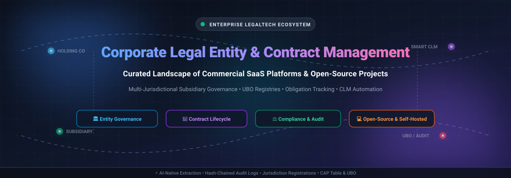

# Awesome-Corporate-Legal-Entity-Contract-Management 🏛️📜

  

  
  
  
  
  
  

---

## 🌟 Top Corporate & Legal Entity Contract Management Ecosystem

> **Curated Directory of Enterprise SaaS Platforms & Open-Source GitHub Repositories**  
> *Specialized in Legal Entity Governance, Multi-Jurisdictional Subsidiary Compliance, Corporate Secretarial Records, and Contract Lifecycle Obligation Tracking.*  
> **Last updated: March 2026** ⚡

---

## 📖 Overview & SEO Summary

Welcome to the definitive awesome list for **Corporate Legal Entity Management (LEM)** and **Contract Lifecycle Management (CLM)** software. Organizations handling complex corporate structures—such as holding entities, international subsidiaries, cross-border joint ventures, and operating branches—require a single source of truth connecting entity corporate registries (statutory filings, beneficial ownership/UBO, cap tables, directors & officers) with contract repositories and contractual compliance obligations.

Whether you are evaluating commercial SaaS solutions (like Diligent Entities, Icertis, Athennian, Computershare GEMS, Ironclad, or Agiloft) or architecting a data-sovereign self-hosted legaltech stack with open-source tools (such as OpenContracts, docassemble, Accord Project Cicero, draftLegal, or @hasna/entities), this guide compiles key platform capabilities, company scale, transparent starting pricing, and repository star metrics.

### 🔍 Key Capabilities Tracked
* 🏢 **Legal Entity Lifecycle Management**: Formation, dissolution, annual statutory filings, registered agent tracking, and officer/director management.
* 👥 **Beneficial Ownership & Cap Table Compliance**: Ultimate Beneficial Owner (UBO) tracing, capitalization structures, and FinCEN/CTA regulatory alignment.
* 📑 **AI-Driven Contract Intelligence & Lifecycle**: Automated drafting, clause library management, redlining, approval chains, e-signatures, and OCR parsing.
* ⏱️ **Post-Signature Obligation Management**: Milestone alerts, renewal/termination notice deadlines, indemnification exposure, and financial audit trails.
* 🛡️ **Self-Hosted & Data-Sovereign Architecture**: On-premise / Docker deployment options ensuring client data confidentiality without enterprise per-seat lock-in.

---

## 📑 Table of Contents
- [📊 Sector Overview & Market Dynamics](#-sector-overview--market-dynamics)
- [☁️ SaaS/Hosted Commercial Platforms](#️-saashosted-commercial-platforms)
- [💻 Open-Source GitHub Projects](#-open-source-github-projects)
- [📈 Star History](#-star-history)
- [🤝 How to Contribute](#-how-to-contribute)
- [💖 Support](#-support)
- [⚠️ Disclaimer](#️-disclaimer)

---

## 📊 Sector Overview & Market Dynamics

The global Contract Lifecycle Management (CLM) and Legal Entity Management software sector is estimated at **$2.5B–$3.5B+ (2025–2026)** and projected to grow at a ~13–15% CAGR driven by regulatory compliance mandates (ESG disclosures, corporate transparency and beneficial ownership rules) and generative AI integration. The sector is **moderately to highly fragmented**—characterized by a diverse ecosystem of specialized corporate governance platforms, multi-billion-dollar enterprise CLM suites, and point solutions, rather than a winner-take-all monopoly.

---

## ☁️ SaaS/Hosted Commercial Platforms

*SaaS platforms ordered descending by company valuation and enterprise scale.*

| 🏢 Product | 💼 Company Scale (Revenue / Valuation) | 📝 Description | 🏷️ Starting Pricing | 🎁 Free Tier / Trial Limits |
|-----------|----------------------------------------|----------------|--------------------|----------------------------|
| **[Computershare GEMS](https://www.computershare.com/)** | **~$10B–$15B Market Cap** (~$3.1B FY25 Revenue) | Stock option plan administration (GEMSᵖᵐ, formerly OPTRACK) with equity management and financial reporting (ASC-718, IFRS-2). The broader Computershare entity solutions portfolio covers corporate trust and governance. | **$40/month** (GEMSᵖᵐ basic tier, TrustRadius listing) | **No free trial or free tier**; access requires an enterprise license or complimentary guided sales demo. |
| **[Icertis](https://www.icertis.com/)** | **$5.0B Valuation** (~$350M ARR) | Enterprise CLM with corporate contract management capabilities. Manages entity-level agreements, obligations, and governance workflows. AI (Vera) extracts and tracks contractual commitments across the entity structure. | **$100,000/year** (Minimum enterprise deployment baseline via Vendr; requires 100-user/3-year minimum commitment) | **No free trial or free tier**; evaluation is available strictly through scheduled sales demos and guided enterprise PoCs. |
| **[Diligent Entities](https://www.diligent.com/)** | **~$4.0B Valuation** (~$325M+ ARR) | Entity management and compliance solution tracking corporate records, filings, governance documents, and regulatory deadlines across multiple legal entities. | **$10,000/year** (Starting tier per Software Advice; <50 entities typically ranges **$20,000–$50,000/year** via Vendr) | **14-day free trial** (for enterprise feature evaluation/AI modules via sales rep activation); no permanent free plan. |
| **[Ironclad](https://ironcladapp.com/)** | **$3.2B Valuation** (~$200M ARR) | CLM with workflow automation, approval routing, and repository management. Can be configured to track entity-specific contract obligations and renewals. | **$40,000/year** (Mid-market baseline contract tier via Vendr; equivalent to ~$200–$600/user/month depending on contract volume) | **14-day free trial** (Sandbox/digital contracting and Contract Review Agent test environment); no permanent free tier. |
| **[Conga](https://www.conga.com/)** | **$715M Acquisition Valuation** (~$400M combined ARR) | CLM and revenue lifecycle platform with approval workflows, contract analytics, and cycle-time reporting. Can be configured for entity-specific contracting processes and compliance rules. | **$35/user/month** (Billed annually for base Composer/Contract modules; average full enterprise deployments start around **$17,000/year** via Vendr) | **30-day free trial** (Available on Conga Composer via AppExchange for up to 10 user licenses); core enterprise CLM requires sales demo. |
| **[SirionLabs](https://www.sirion.ai/)** | **~$1.0B Valuation** (~$40M–$50M ARR) | AI-driven CLM ranked #1 in Advanced Contract Analytics (Gartner 2025). Portfolio-wide risk analytics, obligation monitoring, and natural-language queries across the contract corpus—including entity-level exposure analysis. | **$1,500/user/year** (AppExchange & partner framework list price; typical enterprise deployments start at **$50,000+/year**) | **No free trial or free tier**; custom access requires an enterprise consultation and guided vendor demo. |
| **[ContractPodAi](https://contractpodai.com/)** | **~$600M–$800M Valuation** (~$50M ARR) | AI-powered legal platform (Leah) covering contract management, review/analysis, and legal project management. Role-based access with annual access reviews and segregation-of-duties evaluation for entity-level governance. | **$3,000/month** (Billed annually at **~$36,000/year** for base mid-market deployments; full enterprise suites average $100,000+/year via Vendr) | **No free trial or free tier**; custom access provided exclusively via sales demonstration. |
| **[Agiloft](https://www.agiloft.com/)** | **~$400M–$500M Est. Valuation** (~$60M–$80M ARR) | No-code CLM with entity-aware contract repositories, obligation tracking, and compliance workflows. Integrates with ERP systems for entity-level financial tracking. | **$65/user/month** (Billed annually; median closed enterprise contract value sits at **$67,132/year** per Vendr data) | **Free tier available forever** (Agiloft Astra AI tier includes 1,000 credits/mo, up to 3 custom playbooks/screens, and uncapped Word Add-in usage); no trial for core CLM. |
| **[Athennian](https://www.athennian.com/)** | **~$150M Est. Valuation** (~$10M–$14M ARR) | Entity management platform for legal and finance teams. Three tiers: Essentials (basic compliance tracking), Professional (bulk editing, historical reporting, Open API), Enterprise (advanced security, read API, premium support). Includes UBO tracking, structure charts, and e-filings. | **$25,000/year** (Essentials starting tier covering up to 100 entities; additional entity bundles sold in blocks of 50) | **No free trial or free tier**; platform access is scoped exclusively through a customized sales demo. |

---

## 💻 Open-Source GitHub Projects

*Open-source projects sorted descending by GitHub stargazers count.*

| 📦 Repository | 🌟 Stars_Badge | 📜 Description & Governance Capabilities |
|--------------|--------------|------------------------------------------|
| **[Open-Source-Legal/OpenContracts](https://github.com/Open-Source-Legal/OpenContracts)** |  | **The open document intelligence platform for builders and legal teams.** Document management system (DMS) and contract analytics engine for the AI/agentic era. Provides automated PDF parsing, layout-aware vector search, structural data extraction, and fine-grained annotation tracking across complex enterprise agreements. |
| **[jhpyle/docassemble](https://github.com/jhpyle/docassemble)** |  | **Open-source expert system for guided legal interviews and corporate document assembly.** Powered by Python, YAML, and Markdown. Extensively adopted by legal aid and corporate legal operations for generating complex multi-entity incorporation documents, statutory compliance forms, and custom contracting workflows. |
| **[evolsb/claude-legal-skill](https://github.com/evolsb/claude-legal-skill)** |  | **AI-powered contract review skill with CUAD risk detection.** Analyzes contracts against market standards, identifies problematic indemnity and liability clauses, and creates lawyer-ready redlines compatible with modern AI agent clients and Claude Code. |
| **[accordproject/template-archive](https://github.com/accordproject/template-archive)** |  | **Smart Legal Contracts and computational agreement template archive (Cicero ecosystem).** Industry standard backed by the Linux Foundation for converting natural language legal agreements into executable data models with deterministic clause execution and programmatic compliance checking. |
| **[OCA/contract](https://github.com/OCA/contract)** |  | **Odoo Community Association recurring contract management platform.** Comprehensive business logic module managing contract terms, recurring billing, automated renewals, termination periods, and entity-level accounting ledger linkages under AGPL-3.0. |
| **[accordproject/concerto](https://github.com/accordproject/concerto)** |  | **Data modeling language for legal tech and enterprise assets.** Enables developers to declare strongly typed domain models for corporate entities, governance records, participants, obligations, and contracts across multi-party enterprise architectures. |
| **[bcgov/entity](https://github.com/bcgov/entity)** |  | **Government of British Columbia's open-source legal entity registry system.** ServiceBC Registry Team's production codebase for business entity incorporation, corporate filings, officer registries, and administrative business dashboards. A premier public-sector reference implementation. |
| **[AniketTati/draft-legal](https://github.com/AniketTati/draft-legal)** |  | **AI-native open-source CLM with entity-aware contract operations.** Complete self-hosted platform for draft, review, redline, approval, and obligation tracking. Features portfolio intelligence via hybrid retrieval (pgvector + Elasticsearch + RRF) across corporate contracts and notice deadlines. Full Docker Compose deployment. AGPL-3.0. |
| **[aaked-app/aakd](https://github.com/aaked-app/aakd)** |  | **Self-hostable CLM for reviewed, source-linked contract operations.** Manages agreements, cited review, contractual renewals, approvals, and governed access for AI agents through API and MCP. Built with PostgreSQL, Redis, MinIO, and Mailpit. AGPL-3.0. |
| **[@hasna/entities](https://github.com/hasna/entities)** |  | **System-of-record for legal entity governance & lifecycle management.** Covers formation→dissolution lifecycle, per-jurisdiction registrations (EIN/VAT), registered agents, officers/directors, ownership/UBO cap tables, and statutory filing calendars. Features append-only hash-chained audit logs, MCP server, and REST API. Apache-2.0. |
| **[ConductionNL/shillinq](https://github.com/ConductionNL/shillinq)** |  | **Nextcloud-based business administration suite.** Includes a contract repository, supplier qualification workflows, and purchase order revision tracking for entity-level procurement governance. EUPL-1.2. |

---

### 🧩 Recommended Architecture for Custom Open-Source Systems

When architecting a self-hosted corporate governance stack:
1. **Entity Registry Layer**: Deploy **[@hasna/entities](https://github.com/hasna/entities)** or reference **[bcgov/entity](https://github.com/bcgov/entity)** for canonical entity master records, officer rosters, and hash-chained audit trails.
2. **Contract Lifecycle Layer**: Use **[draftLegal](https://github.com/AniketTati/draft-legal)** or **[aaked-app/aakd](https://github.com/aaked-app/aakd)** for end-to-end authoring, approvals, redlining, and post-signature obligation monitoring.
3. **Document Intelligence & Assembly**: Leverage **[Open-Source-Legal/OpenContracts](https://github.com/Open-Source-Legal/OpenContracts)** for automated parsing and clause retrieval, and **[jhpyle/docassemble](https://github.com/jhpyle/docassemble)** for corporate resolution/bylaw document generation.
4. **Data Modeling & Standards**: Adopt **[accordproject/concerto](https://github.com/accordproject/concerto)** and **[accordproject/template-archive](https://github.com/accordproject/template-archive)** to ensure standardized computational legal agreements.

---

## 📈 Star History

---

## 🤝 How to Contribute

We welcome community contributions from corporate secretaries, legaltech developers, and compliance engineers!

1. 🍴 **Fork the repo** to your GitHub account.
2. ✍️ **Add or edit entries** in `README.md` following the standard table formatting.
3. 📌 **Include essential details**: Product name, official link, transparent starting pricing, free tier/trial limits, and precise feature summaries.
4. 🚀 **Submit a Pull Request** with a descriptive title and summary of changes.

---

## 💖 Support

Thank you for exploring and utilizing this curated repository! If this guide helped you evaluate corporate entity management solutions or discover self-hostable legal tools, please consider supporting the project:

- ⭐ **Star this repository** to help others discover it on GitHub.
- 🍴 **Fork the project** and contribute additions or updates.
- 📢 **Share this list** with your peers, legal operations, and engineering teams.
- ☕ **Sponsor the author / Buy a coffee**: Support ongoing maintenance and curation on the [Sponsor Dashboard](https://github.com/sponsors/ishandutta2007).

---

## ⚠️ Disclaimer

* This repository is a **community-curated index** provided for informational and educational purposes only; it does not constitute legal, tax, or financial counsel.
* Corporate entity management involves legally critical governance records (UBO declarations, statutory deadlines, officer appointments); ensure rigorous access controls, regular audits, and compliance with local jurisdictional laws.
* Commercial pricing and trial options reflect market research and published vendor indicators as of early 2026 and are subject to change by respective software providers.

---

  <b>Built with care for corporate secretaries, general counsels, compliance officers, and legaltech builders. 🏛️⚖️</b> 
  Let's make corporate entity governance and contract lifecycle management open, auditable, and accessible.

